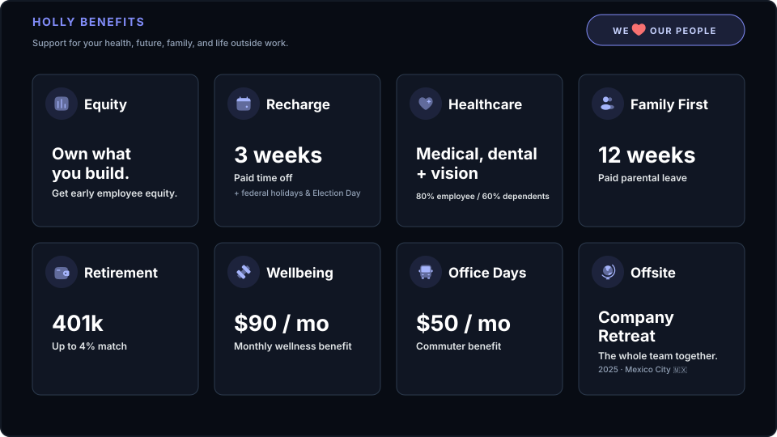
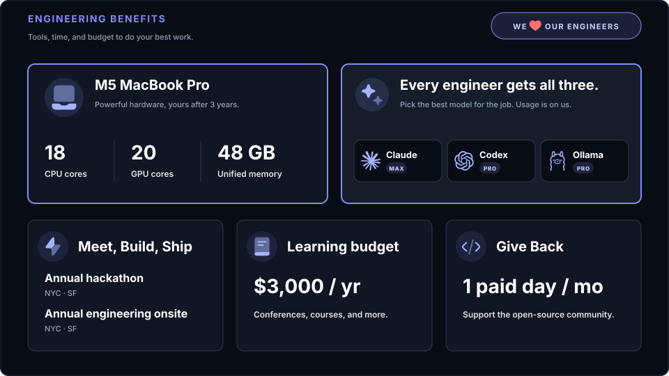
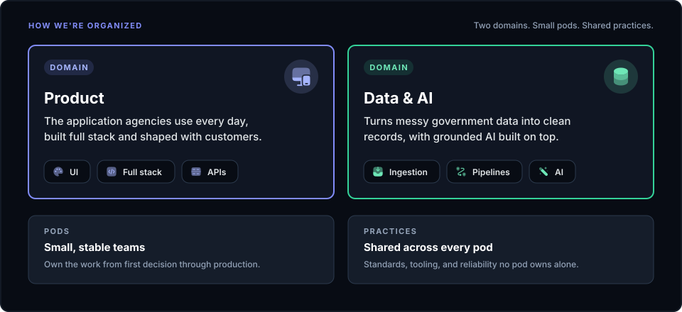
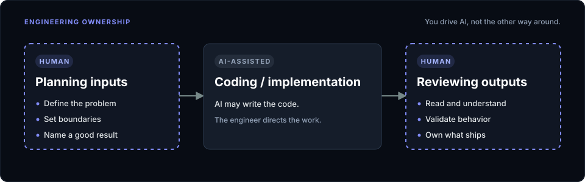
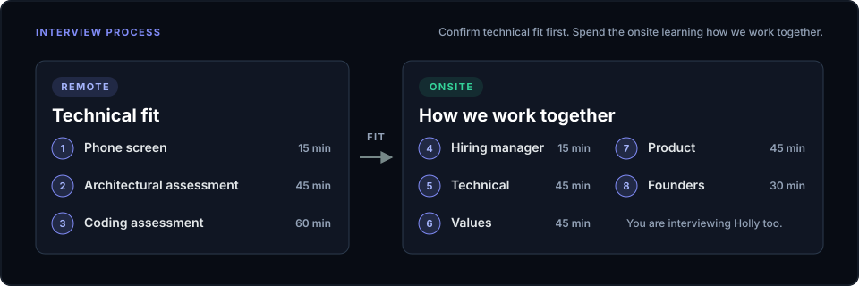

  

  The home of engineering recruiting at <a href="https://github.com/holly-revamp">Holly</a>.

  
  
  

# Engineering at Holly

We are a small team building software government actually deserves. Engineers work directly with
customers and domain experts, then own the solution from the first product decision through
production. You get the speed and autonomy to do your best work without layers of process in the
way.

- 🚀 **Ship constantly:** Every merge to `main` ships to production (10 deployments per day on
  average).
- ✨ **Build AI-native:** Use the latest models and agent tooling every day, with room to push how
  software gets built.
- 🛠️ **Use modern tools:** Work across a current TypeScript stack and adopt better tools when they
  earn their place.
- ⚡ **Own the outcome:** Control the scope, architecture, implementation, and production result.

## How we invest in our team

Holly pairs company-wide health, retirement, leave, wellness, and equity benefits with the tools,
budget, and time engineers need to do exceptional work.

### Benefits for life

View Summary of Benefits and Coverage documents

- **Healthcare:**
  [Platinum plan (PDF)](https://d2ed110nmrd591.cloudfront.net/blobs/NeTZvctxJCMeT2z4m8NdDmYN.pdf),
  [Gold plan (PDF)](https://d2ed110nmrd591.cloudfront.net/blobs/VoUXqENhAEKRyoqhxfy2bgex.pdf),
  and [Silver plan (PDF)](https://d2ed110nmrd591.cloudfront.net/blobs/QGkC5ntqsHUdK5vgRUW3L6Ko.pdf)
- [Dental plan (PDF)](https://d2ed110nmrd591.cloudfront.net/blobs/UxLRPJdHJ4xaHNk1MSMcuNgG.pdf)
- [Vision plan (PDF)](https://d2ed110nmrd591.cloudfront.net/blobs/H4tgrsjM429neBDwsx7zwNvi.pdf)

### Built for engineers

## How we're organized

Engineering works in two delivery domains:

- **Product:** the customer-facing application agencies use every day, built full stack.
- **Data & AI:** the platform that turns messy government data into clean records, and the AI built
  on top of it.

Inside each domain, small, stable pods own the work from first decision through production, and
practices share standards and tooling across every pod.

🛰️ Pods are named after NASA missions, so a team's identity does not change every time the roadmap
does.

## How we build

We favor small, composable systems, clear ownership, and tools that make the right thing easy. AI
is part of our daily workflow, but the engineer remains accountable for the inputs, the review, the
validation, and what ships.

- 🎯 **Work on what matters:** Default to no, then spend your time on the problems that move the
  product and the business.
- 🗣️ **Question everything:** Titles do not settle technical arguments. The better case wins.
- 🧰 **Obsess over craft:** Build work you would put your name on. Quality does not get traded for
  an arbitrary date.
- 🔁 **Own it end to end:** Scope it, build it, test it, ship it, and operate it in production.

We write TypeScript end to end with Node.js, React, TanStack, Tailwind, and Elysia, backed by
PostgreSQL. We deploy across GCP and Render with Pulumi, build AI with OpenAI and Anthropic, and run
the monorepo on pnpm, Turborepo, Oxc, Vitest, and Massaman.

  
  &nbsp;&nbsp;
  
  &nbsp;&nbsp;
  
  &nbsp;&nbsp;
  
  &nbsp;&nbsp;
  
  &nbsp;&nbsp;
  
  &nbsp;&nbsp;
  
  &nbsp;&nbsp;
  
  &nbsp;&nbsp;
  

  
  &nbsp;&nbsp;
  
  &nbsp;&nbsp;
  
  &nbsp;&nbsp;
  
  &nbsp;&nbsp;
  
  &nbsp;&nbsp;
  
  &nbsp;&nbsp;
  
  &nbsp;&nbsp;
  

View the stack, logo by logo

1. **TypeScript:** The language, end to end
2. **Node.js:** Server runtime
3. **React:** UI
4. **TanStack:** Routing, data fetching, and app framework
5. **Tailwind CSS:** Styling
6. **Elysia:** HTTP APIs
7. **PostgreSQL:** Primary database
8. **Hatchet:** Background tasks and durable workflows
9. **VoltAgent:** AI agent framework
10. **Google Cloud:** Cloud platform
11. **Pulumi:** Infrastructure as code
12. **pnpm:** Package manager
13. **Turborepo:** Monorepo builds
14. **Oxc:** Linting and formatting
15. **Vitest:** Testing
16. **Viteval:** LLM evaluations on Vitest
17. **Massaman:** Functional utilities for TypeScript

# How we interview

Our engineering interviews combine structured conversations with work that resembles the job. The
same core sequence applies to all engineering roles and only the technical content changes with the
role.

## Our interview philosophy

AI has changed how engineers build software. It has not replaced engineering fundamentals or the
judgment required to ship software people can trust.

Writing code is getting cheaper. Deciding what to build and determining whether the result is safe,
correct, and useful are not. That is why our interviews focus on how you frame the problem and
review the output, not how quickly you can produce code.

> [!IMPORTANT]
> We do not use LeetCode or abstract puzzles. Every technical prompt comes from a system Holly has
> already built in some form. That gives us a concrete basis for the discussion and gives you a fair
> picture of the work you would do here.

We evaluate four things:

- **Independent judgment:** Can you reason about a system, find risk, and make technical decisions
  without outsourcing the thinking to AI?
- **Communication:** Can you explain assumptions and tradeoffs, ask for missing context, and help
  other engineers make better decisions?
- **AI fluency:** Can you give an agent useful context, choose the right work to delegate, and
  inspect its output instead of accepting it blindly?
- **Delivery:** Can you reduce ambiguity, choose a useful scope, and move a real codebase toward a
  requirement?

## Our interview process

Four stages take you from the first conversation to meeting the full team. We confirm technical
fit before the onsite so neither side invests three hours before the role is a strong match.

### 1. Phone screen (15 minutes)

A focused conversation about the role, your background, and logistics.

View phone screen details

We use the phone screen to understand mutual fit and whether the role matches what you want to do
next. There are no technical exercises and no preparation is required.

### 2. Architecture assessment (45 minutes)

A collaborative system-design discussion based on a system Holly has already built.

View architecture assessment details

This is a **45-minute collaborative design discussion** based on a system Holly has already built.
We provide the problem. You ask questions, state assumptions, sketch the system, and work through
tradeoffs with the interviewer. You do not need to write code or choose a specific framework.

**NO AI** is allowed during this assessment. We want your reasoning: how you break down the problem,
define boundaries and data flow, handle failure and security, and sequence a first production
version. There is no hidden perfect architecture. A simple diagram that supports a clear discussion
is enough.

### 3. Coding assessment (60 minutes)

A practical code review and AI-assisted implementation exercise in a small Holly-style codebase.

View coding assessment details

We use two small faux applications (Smally and Dally) to keep the assessment close to day-to-day
engineering at Holly. Candidates receive access to one private repository based on the role.

#### Format and AI policy

We share the repository roughly **one hour before the call** so you can clone it, start the local
services, and get your bearings.

The assessment has two working sessions with different AI policies. Reviewing without AI isolates
your engineering judgment. Building with AI shows how you direct the tools, validate their work,
and remain accountable for what ships.

1. **Code review (~20 min):** Review a small pull request in GitHub as you would at work.
   Look for correctness issues, bugs, security and data-boundary problems, maintainability concerns,
   and places where the implementation misses its requirements. **NO AI** is allowed in this
   portion. We want to see your judgment as the human guardrail for AI-generated code.
2. **Feature implementation (~30 min):** Build a small feature from a written prompt. Use
   whatever AI and development tools you normally use. We reserve an additional **10-minute
   buffer** for setup, discussion, or more implementation time if you need it.

The pull request and feature are modeled after ordinary product and platform work. A complete
production system is not the expectation.

#### Prerequisites

Have these ready before the coding assessment:

| Tool | Version | Notes |
| --- | --- | --- |
| [Node.js](https://nodejs.org/en/download) | 26 | JavaScript runtime used by both assessment repositories. |
| [pnpm](https://pnpm.io/installation) | 11 | Package manager for the monorepo. |
| [Docker Desktop](https://www.docker.com/products/docker-desktop/) | Latest | Runs PostgreSQL, object storage, workers, and the local model through Docker Compose. |
| [Git](https://git-scm.com/downloads) | Latest | Used to work with the private assessment repository. |
| [GitHub account](https://github.com/signup) | Any | We grant your account access before the interview. |

The local model is designed for an Apple Silicon Mac with an **M2 or newer** and at least **24 GB of
memory**. If your machine differs, tell your recruiting contact before the assessment. We will
adjust the environment.

The first startup downloads a roughly 1.28 GB model. Docker caches it for later runs. The private
repository includes the full setup process, seeded data where needed, the task prompt, and the same
`pnpm validate` command used by CI.

#### Smally — Product engineering

**Smally** (Small + Holly) is a focused class-specification editor and the assessment environment
for product engineering roles. It covers the full path from a PostgreSQL data model to an
AI-assisted React interface.

| Area | Technology |
| --- | --- |
| Language and runtime | TypeScript, Node.js 26 |
| Application | React 19, TanStack Start, TanStack Router, Vite |
| Editor | Tiptap |
| Authentication | Better Auth |
| Data | PostgreSQL 18, Drizzle ORM |
| AI | Vercel AI SDK, a local Qwen model served by llama.cpp |
| UI | Tailwind CSS, shadcn/ui |
| Monorepo and quality | pnpm, Turborepo, tsgo, oxlint, oxfmt |

The Smally review spans a small end-to-end product change across the React application, server
functions, database schema, and shared UI. Expect to trace data through those layers, check auth and
ownership boundaries, and decide whether the implementation and validation support its claims. The
feature portion asks you to extend the same application without rewriting its foundations.

#### Dally — Data & AI engineering

**Dally** (Data + Holly) is a local CSV-import environment and the assessment for Data & AI
engineering roles. It stores source files, dispatches durable import workflows, parses and persists
records, extracts structured dataset insights with a local model, and exposes the full pipeline
through an operations console.

| Area | Technology |
| --- | --- |
| Language and runtime | TypeScript, Node.js 26 |
| API and contracts | Hono, Zod 4, Massaman |
| Operations console | React 19, Vite 8, Tailwind CSS 4, shadcn, Radix UI, TanStack Table, Recharts |
| Ingestion | CSV upload and parsing with `csv-parse` |
| Workflows | Hatchet workers and durable tasks |
| Data | PostgreSQL 18.4, Drizzle ORM |
| Object storage | MinIO through the S3-compatible AWS SDK client |
| AI | Vercel AI SDK 7, Qwen3 1.7B served locally by llama.cpp |
| Monorepo and quality | pnpm 11, Turborepo, tsgo, oxlint, oxfmt, Vitest |
| Runtime | Fully local Docker Compose environment |

Expect to reason about untrusted CSV data, schema validation, idempotency, retries, source
artifacts, and workflow failure modes. We care about traceable results and deterministic tests for
model-backed behavior.

### 4. Onsite (3 hours)

Four focused conversations with the team, with no additional technical exercises.

View onsite details

The onsite is a set of shorter conversations, not another round of technical exercises.

1. **Technical (45 min):** Discuss technical decisions and past work with two Holly engineers. We
   are looking for depth in your domain, judgment, and how you collaborate with peers.
2. **Values (30 min):** Talk through how you work, give and receive feedback, and operate on an
   early-stage team.
3. **Product (30 min):** Connect engineering decisions to customer problems, product judgment, and
   prioritization.
4. **Founders meet and greet (30 min):** Learn where Holly is going and ask the questions you need
   to decide whether you want to help build it.

🍣 **Lunch will be provided** when the onsite overlaps lunchtime.

Once you reach the onsite, the focus widens from proving technical fit to understanding how we would
work together. It is also your best opportunity to interview us.

## What you can expect from us

- Ask questions and state assumptions. Ambiguity is part of engineering. Guessing what answer we
  want is not.
- Think out loud when it helps. We care more about your decisions than typing speed, memorized
  syntax, or a beautiful architecture diagram.
- Treat the interviewer as a collaborator. We will answer domain questions, clarify requirements,
  and help with environment problems.
- Change direction when new information warrants it. Recognizing a bad path is a positive signal.
- Do not optimize for finishing everything. A sound, tested slice with clear next steps is better
  than a rushed implementation you cannot defend.

Every conversation includes time for your questions. If you need an accommodation or the provided
environment does not work on your hardware, tell us. We will adjust it. Setup friction,
accessibility needs, and the computer you own are not part of the evaluation. If you join Holly, a
shiny new work laptop will be waiting on your first day!

<h3 align="center">Build software government actually deserves.</h3>

Small team. Real ownership. Public-service impact.

  

